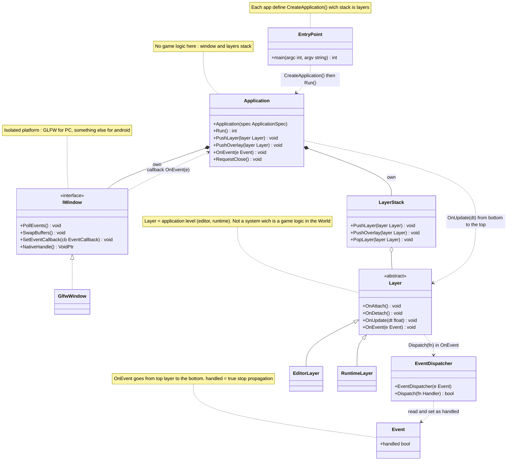
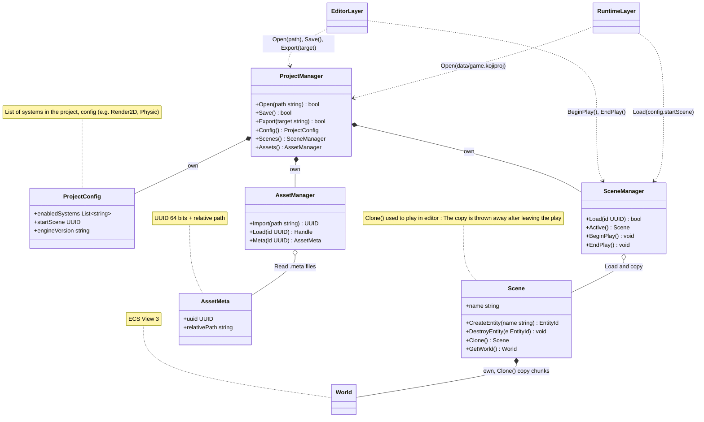
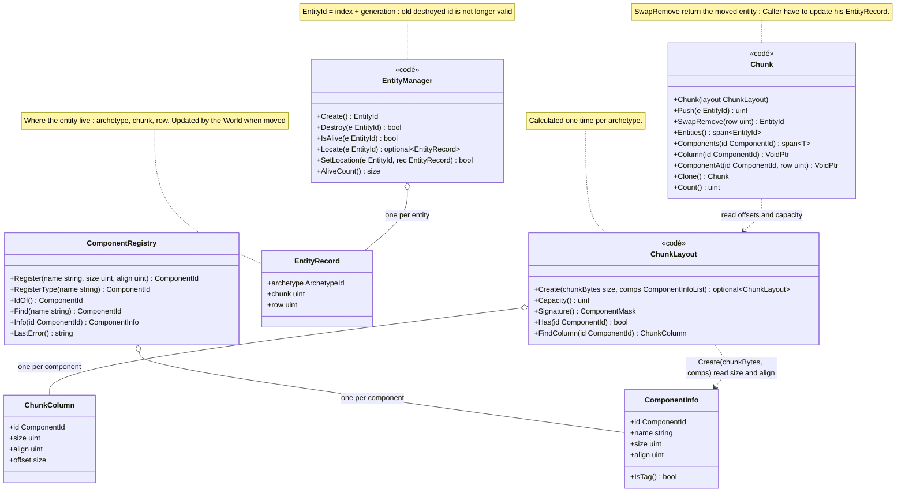
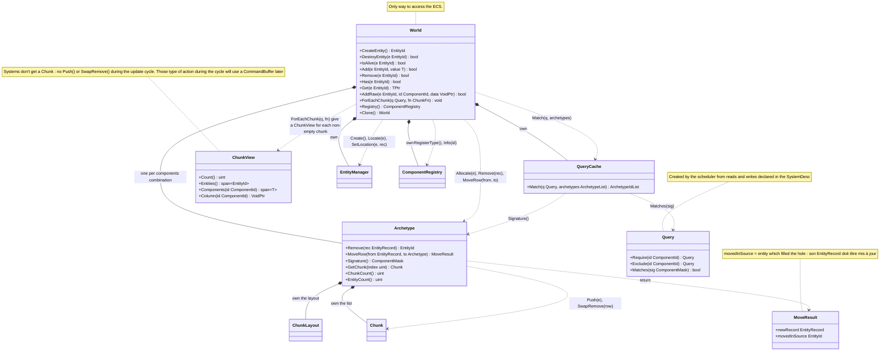
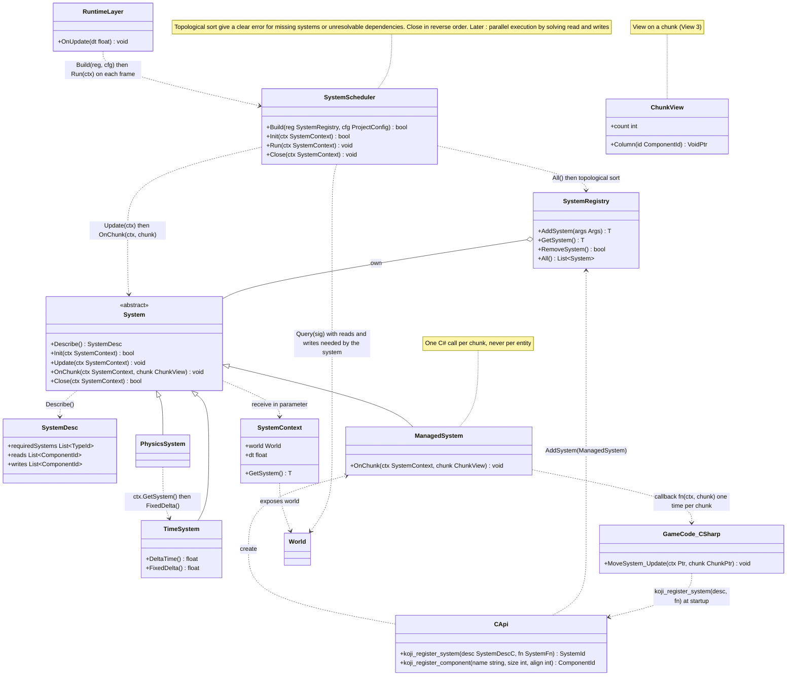

## View 1 - Application, Layers, Window and Events

## View 2 - Project, Scene and Assets

## View 3 - KojiECS: Entities and Components storage

## View 4 - KojiECS: World, archetypes and requests

## View 5 - KojiECS: Systems
